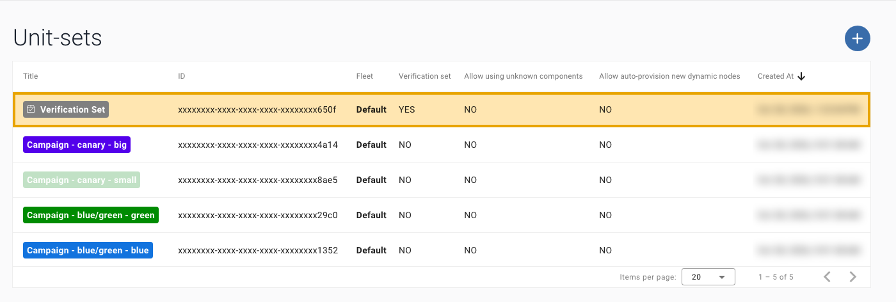
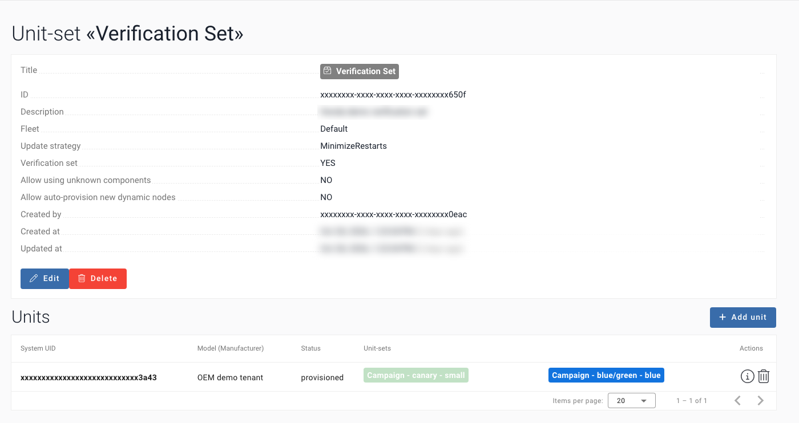
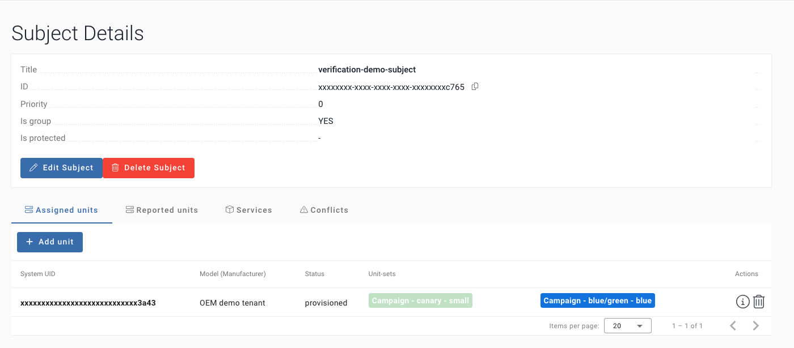
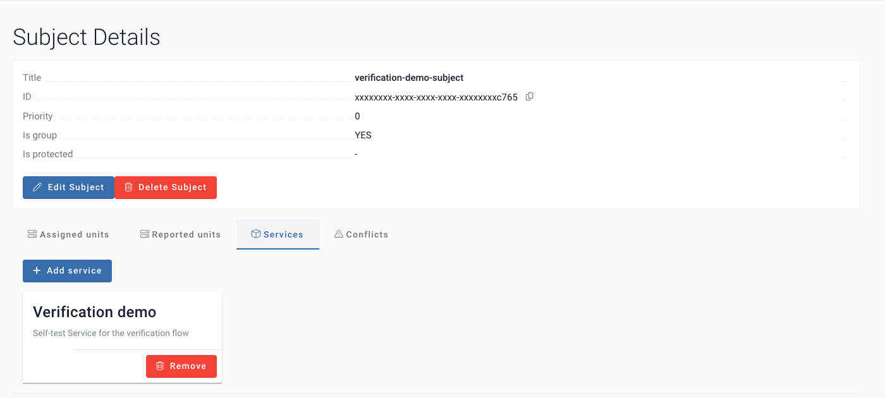
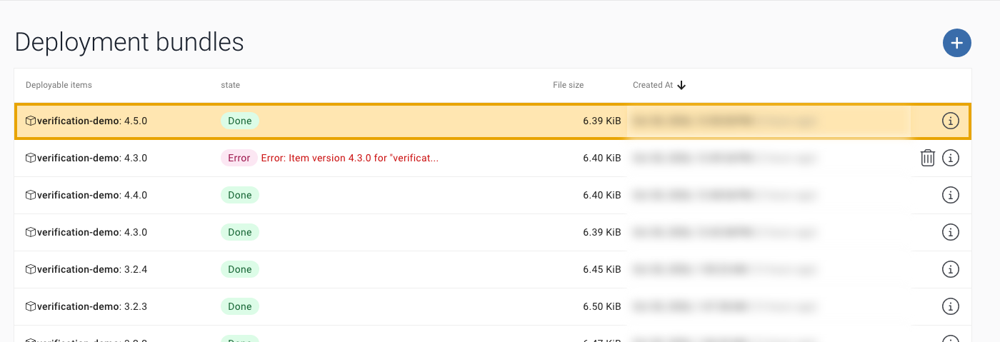
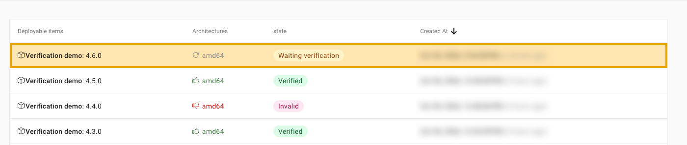
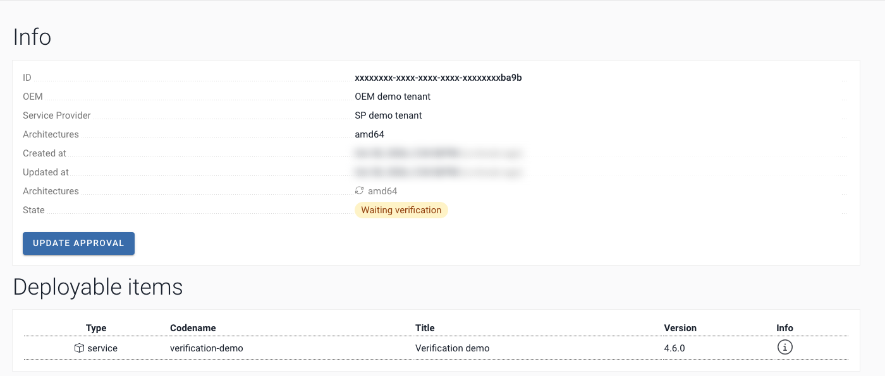
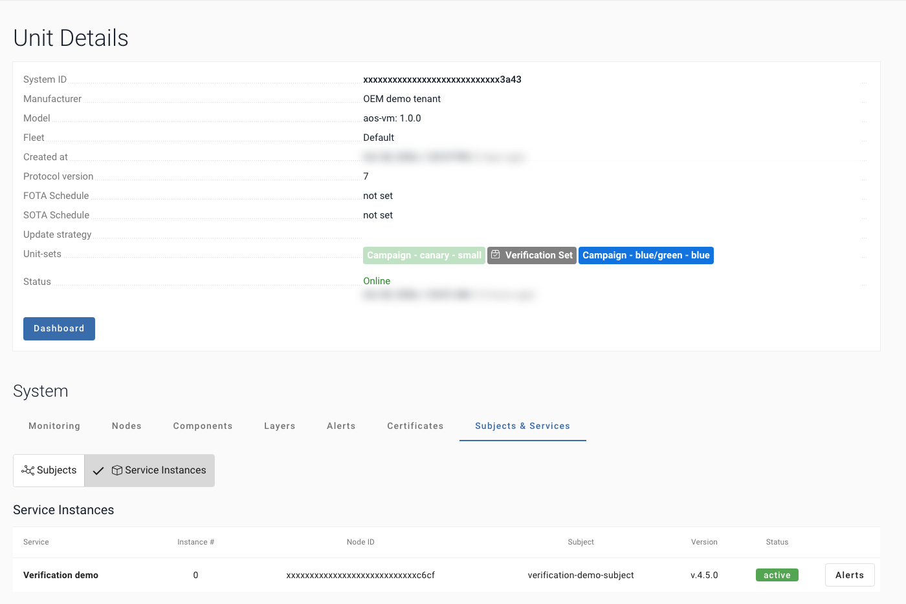
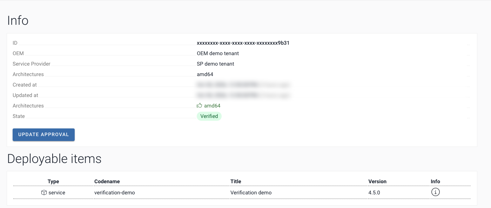
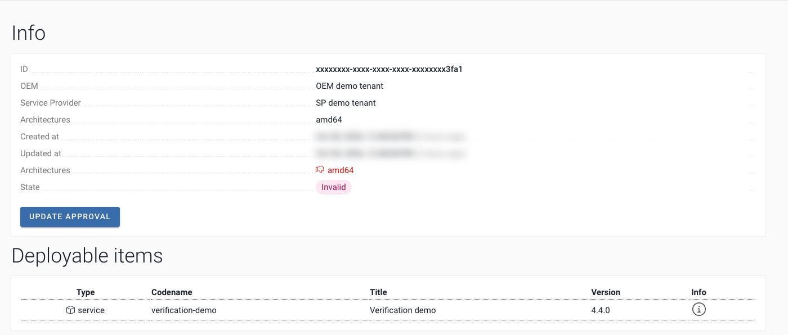

# Automatic verification of a new Service version

A GitHub Actions job finds a new Service version waiting in AosCloud, checks it on the Verification Set Units, and approves or rejects it with one AosCloud API call.

![Automatic verification of a new Service version. The upload job, an existing step, uploads the Service version. AosCloud creates a Verification batch, state Waiting verification, and installs the new Service version only on the Units of the Verification Set. Step 0: watch-batches.yml polls AosCloud every 5 minutes: is a new Service version waiting for verification? AosCloud sends no notification to a pipeline, so the job asks. 5 minutes is the shortest GitHub schedule; GitHub may start runs late or skip them; for a guaranteed start use Start A. Two starts: Start A, chain: the upload job starts verify-batch right after the upload. Start B, watch: watch-batches starts verify-batch when it finds a waiting batch. verify-batch.yml: 1 Wait until the Service version is active on every Verification Set Unit; a timeout or an offline Unit means no decision. 2 Test: built-in checks and partner tests, report.html and junit.xml. 3 Decide: auto, the default, the job approves or rejects; report-only, a person decides in the SP UI. Verified goes on to the normal rollout; Invalid: the rollout stops.](docs/img/flow.svg)

## Step by step

| # | Step | Runs where | What is checked / decided | Where you see it |
|---|---|---|---|---|
| 1 | Upload (existing step) | CI pipeline | New Service version sent | SP UI: Deployment bundles |
| 2 | Verification batch created | AosCloud | State: Waiting verification | SP UI: Verification batches |
| 0 | Watch asks every 5 min (or Start A) | `watch-batches.yml` | New Service version waiting? | Job log |
| 5 | Wait | `verify-batch.yml` | Verification Set Units active | Job log |
| 6 | Test | `verify-batch.yml` | Built-in checks + partner tests | `report.html` |
| 7 | Decide | `verify-batch.yml` | `auto`: the job. `report-only`: a person | Job log; report |
| – | Result | AosCloud | Verified / Invalid | SP UI: Verification batches |

## How the job knows it is time

| Question | Answer | Where it comes from |
|---|---|---|
| Which Service version? | The highest Service version, if its Verification batch is Waiting verification. Older waiting batches are left alone | `AOS_SERVICE_ID`; `GET verification-batch/` |
| Which Units? | The Verification Set Units linked to the Service by the Subject: a Unit has to be in both | `GET verification-batch/{id}/statistics/` ∩ `GET services/{id}/units/` |
| Which tests? | The built-in checks, then the partner tests | `tests/run_tests.sh`, `tests/your_tests.sh` |
| Did the deployment succeed? | Each Unit: online, Service version installed, instance active. One failed Unit rejects the Service version; a Unit offline or never updated ends in a timeout and no decision | `GET units/{id}/subjects-services/{service id}/` |

> [!IMPORTANT]
> **Defaults:** the job decides by itself (`AOS_DECISION=auto`). For a decision by a person, set `AOS_DECISION=report-only`: the job only checks and writes the report, and a person approves or rejects in the SP UI. Or `ask` (laptop only).
>
> Built-in checks run on every Service version (A1, B1, C2; C3/C4 unless `AOS_WATCH_SECONDS=0`). Partner tests go in `tests/your_tests.sh` (start from `tests/your_tests.sh.example`): they run after the built-in checks. If any check or test fails, the verdict is reject; in `auto` mode the job sends it, in `report-only` a person decides.

<details>
<summary>Why every 5 minutes?</summary>

AosCloud does not notify a pipeline when a new Service version waits (no webhook), so the watch asks every 5 minutes. 5 minutes is the shortest interval GitHub allows. GitHub may start runs late or skip them; for a guaranteed start use Start A. Each run takes about 20 s and only reads. To change it, edit one line in `watch-batches.yml`: `cron: "*/5 * * * *"` → `"*/10 * * * *"` (every 10 min), `"*/30 * * * *"`, `"0 * * * *"` (hourly). GitHub cannot read this from a variable. Faster than 5 min, or exact timing: start `verify-batch` right after your upload job (Start A, the chain), or use an external scheduler. A webhook from AosCloud would make it instant (feature request).

</details>

**[Set it up in GitHub](#set-it-up-in-github)** · **[Try it on a laptop](docs/run-locally.md)**. Both need the
[Prerequisites](#prerequisites): a Service, and verification set up in AosCloud.

## How to use this repository

1. [Set it up in GitHub](#set-it-up-in-github): the workflow files and the secrets.
2. [Try it on a laptop](docs/run-locally.md): `./aos-verify setup`, upload, `./aos-verify run`.
3. [Prerequisites](#prerequisites): a Service, verification set up in AosCloud, a Service version uploaded.
4. [What the job does](#the-verification-job-in-3-steps), and its [parameters](#parameters).
5. [Partner tests](docs/tests.md): what `tests/run_tests.sh` checks, the report, and how to add partner tests.
6. [Example checks](docs/checks.md): 12 scenarios we ran on production, step by step, if you have no tests yet.
7. [API reference with examples](docs/api.md): every call, with `curl`.
8. [FAQ and tips](docs/faq.md).

## Set it up in GitHub

1. **Copy the two workflow files into your repository**, with the code they run. From the folder of this example:

   ```bash
   cp -R .github verify_batch.py tests /path/to/your-repo/
   ```

2. **Add the secrets.** One helper prints exactly what to paste. It makes the PEM from your `.p12`, finds the root CA and
   your Service (the first time it asks, as `setup` does), and never prints the key:

   ```bash
   ./aos-verify secrets --repo your-org/your-repo
   ```

   ```text
   gh api -X PUT repos/your-org/your-repo/environments/aos-verification
   gh secret set AOS_USER_PEM --repo your-org/your-repo --env aos-verification < '…/.aos-verify/user.pem'
   gh secret set AOS_ROOT_CA_PEM --repo your-org/your-repo --env aos-verification < '…/.aos-verify/aos-root-ca.crt'
   gh secret set AOS_SERVICE_ID --repo your-org/your-repo --env aos-verification < '…/.aos-verify/service_id'
   gh secret set AOS_API_URL --repo your-org/your-repo --env aos-verification --body 'https://api.aoscloud.io:10000/api/v11'
   ```

   Creating the environment needs admin rights on the repository.

3. **Commit to the default branch.** Done. The watch finds each new Service version by itself, and
   [`verify-batch`](.github/workflows/verify-batch.yml) checks it and decides, by itself
   ([Automatic decision](#automatic-decision) says how to change that). Add partner tests in
   [`tests/your_tests.sh`](docs/tests.md).

## Who tells whom

AosCloud sends no notification to a pipeline; a webhook would replace the watch. So the pipeline asks, on a
schedule, with the SP certificate alone. Nobody presses anything.

![How the pipeline learns that a Service version waits. 1, upload with aos-signer upload, an existing step. 2, AosCloud creates a Verification batch, Waiting verification; the Service version goes only to the Set. 3 and 4, the Service version is installed on the Test Units, and they report installed, active or failed. 0, the new step: watch-batches.yml repeats every 5 minutes: is a new Service version waiting for verification? GET Verification batches, statistics and Units returns the batch id, the Service version and the Unit ids of the Set. It starts verify-batch.yml, one run per batch; or Start A: the upload job starts it right after the upload. 5, wait: each Unit until active or failed. 6, built-in checks and partner tests, then the report. 7, decision: auto, one PATCH, approve or reject, only while still Waiting verification; report-only, no PATCH, a person decides in the SP UI. Verified goes to the normal rollout; Invalid: the rollout stops.](docs/img/sequence.svg)

| Who | Tells whom | What | Where you see it |
|---|---|---|---|
| Your upload job | AosCloud | a new Service version | the job log; SP UI → Deployment bundles |
| AosCloud | the test Units of the Verification Set | install this Service version | SP UI → Verification batches: Waiting verification |
| A test Unit | AosCloud | installed, and active or failed | SP UI → Unit → Subjects & Services → Service Instances |
| AosCloud, when the watch asks | the watch | the batch id, the Service version, the Unit ids of the Set | the log of `watch-batches`; the title of the `verify-batch` run |
| The verification job | AosCloud | one decision: approve or reject | the report; SP UI: Verified or Invalid |

Two automatic starts, no buttons:

- **The chained start:** your upload job calls the verification right after the upload, in the same workflow.
- **The watch:** it asks AosCloud itself and finds any upload, wherever it came from. GitHub runs a schedule on a best-effort basis, so the watch can be late.

Both end in the same `verify-batch`, in one queue per Service version, and cannot double-decide: a second run waits for the first, finds the batch decided, and sends nothing.

Note: `discover` ran read-only on production 6.1.97 and on staging 6.2.31 on 04.11.2026, and the upload-to-decision
steps ran on production on 30.10.2026. The scheduled watch itself has so far run only against a mock.

Tested end to end from a terminal on production AosCloud 6.1.97 on 30.10.2026, with the same three steps the job
runs: upload → the Service version active on the test Unit in about 15 s → tests → approved → Verified.

## What is in this repository

Files: [`aos-verify`](aos-verify) (setup and one command, for a laptop), [`verify_batch.py`](verify_batch.py) (about 500 lines, Python 3.10+ and `requests`),
[`tests/run_tests.sh`](tests/run_tests.sh) (the built-in checks, then partner tests) with [`tests/report.py`](tests/report.py)
(the HTML report) and [`tests/your_tests.sh.example`](tests/your_tests.sh.example),
[`.github/workflows/watch-batches.yml`](.github/workflows/watch-batches.yml) (the watch),
[`.github/workflows/verify-batch.yml`](.github/workflows/verify-batch.yml) (the job) and
[`examples/release-caller.yml`](examples/release-caller.yml).

## Prerequisites

### Before you start

GitHub Actions must be enabled for the repository. Organisation owners can switch Actions off for a repository or allow only selected actions; a maintainer cannot see this setting. Workflows used: actions/checkout, actions/setup-python, actions/upload-artifact.

### 1. A Service that your pipeline already deploys (SP)

1. The Service exists in AosCloud for your Service Provider (SP) account: SP UI → Services, or
   `POST services/ {title, codename, default_quotas}`
   ([services_create](https://api.aoscloud.io/api/v11/docs#/services/services_create)).
2. Note its **Service id**. The job finds the Service version by this id. It is the `id` of the item with your `codename` in
   `GET services/?search=<codename>` ([find the Service id](docs/api.md#find-the-service-id)).
3. Your pipeline signs and uploads it with `aos-signer`, using the SP user certificate (`.p12`).

### 2. Verification configured (OEM)

The OEM account does these steps once. The new Service version then goes to these Units first, and to no other Unit.

1. **Create the Verification Set**: a Unit Set with **Verification set = YES**, in the fleet of the test Units.
   OEM UI → Unit-sets → +, or `POST unit-sets/ {title, is_validation_set: true, fleet, description}`
   ([unit_sets_create](https://api.aoscloud.io/api/v11/docs#/unit-sets/unit_sets_create)).

   

2. **Add the test Units** to it: Add unit, or `POST unit-sets/{id}/units/ {system_uids}`
   ([unit_sets_units_create](https://api.aoscloud.io/api/v11/docs#/unit-sets/unit_sets_units_create)).
   The Units must be provisioned and online.

   

3. **Create a Subject for the test Units**: a group Subject, priority 0, with the test Units assigned.
   `POST subjects/ {label, is_group: true, priority: 0}`
   ([subjects_create](https://api.aoscloud.io/api/v11/docs#/subjects/subjects_create)), then
   `POST subjects/{id}/units/ {system_uids}`
   ([subjects_units_create](https://api.aoscloud.io/api/v11/docs#/subjects/subjects_units_create)).

   

4. **Give your Service to the Subject**: Services tab → Add service, or `POST subjects/{id}/services/ {service_ids}`
   ([subjects_services_create](https://api.aoscloud.io/api/v11/docs#/subjects/subjects_services_create)).
   Without this link the Service version is never installed on the test Units.

   

You do not need to give the job the ids of the test Units: with the SP certificate it reads them from each Verification batch
([which Units](docs/api.md#the-units-of-the-verification-set)). The SP cannot read Unit Sets directly.

### 3. A Service version uploaded, so that a Verification batch exists (SP)

1. In the `config.yaml` of the Service, these parameters matter:

   | Parameter | Why |
   |---|---|
   | `items[].identity.codename` | the codename of your Service |
   | `items[].identity.id` (optional) | your Service id: the upload adds a Service version to that Service |
   | `items[].version` | the new Service version. It must be higher than the last one and never uploaded before |
   | `items[].images[].archInfo.architecture` | what the image is built for. The batch lists the architectures it needs an approval for: for example, `amd64` for an image built for `any`. `decide` sends one approval for each |
   | `publish.tlsKey` | the path of the SP `.p12`. Keep the file out of the repository |

2. Run `aos-signer sign` and `aos-signer upload` in the folder of the Service.
3. SP UI → Deployment bundles: the Service version is **Done**. An **Error** such as "Item Service version … already exists" means
   that the Service version was reused: raise it.

   

4. SP UI → Verification batches: AosCloud creates one batch per uploaded Service version. It waits for a decision, with no
   time limit: the API state is `Waiting_validation`, and the UI shows **Waiting verification**.

   

   

## The verification job in 3 steps

All calls use mutual TLS with the SP certificate on `https://<api host>:10000/api/v11/`. Each call links to its
description, with a `curl` example and a sample response, in the [API reference](docs/api.md).

### 1. Wait: `verify_batch.py wait`

It finds the Verification batch of this Service and Service version, takes the test Units from AosCloud (or from the `units` input or
`AOS_TEST_UNITS`, if you set them), then waits until the Service version runs on every test Unit.

- `GET verification-batch/?ordering=-created_at&limit=50&offset=<n>`, page by page: [find the batch](docs/api.md#find-the-verification-batch)
- `GET verification-batch/{batch_id}/`: [check that it still waits](docs/api.md#read-the-verification-batch)
- `GET verification-batch/{batch_id}/statistics/` and `GET services/{service_id}/units/`: [the test Units](docs/api.md#the-units-of-the-verification-set).
  Units you give must be in the Set, and every architecture of the batch needs one, because the decision covers them all
- `GET units/{unit_id}/`: [is the test Unit online](docs/api.md#is-the-unit-online)
- `GET units/{unit_id}/subjects-services/{service_id}/`: [the Service version on each test Unit](docs/api.md#read-the-service-version-on-a-unit)

Exit 0: ready, and the batch id is printed. Exit 1: the Service version failed to start on a Unit, the batch id is printed,
and the job rejects. Exit 2: timed out, no batch, the batch is already decided, or an error that waiting cannot fix
(a setting, a TLS error, an HTTP 4xx answer); the job decides nothing. Exit 3: timed out while AosCloud could not be
reached or a test Unit was offline; the job decides nothing. Only a lost connection, a timeout and HTTP 5xx are retried.



### 2. Test: `tests/run_tests.sh`

The built-in checks run first: they read the Verification batch and the Units again (exactly this Service version, on every Unit, no crash) and
observe the Service version for 60 s (late failure, restarts). Then partner tests, from `tests/your_tests.sh` when you add it
([Partner tests](docs/tests.md)), in a step of their own, with no secret. Exit 0 when every check passed, 1 when a check
failed, 3 when AosCloud could not be read or a test Unit is offline: neither decides anything. It writes `report/report.html` and
`report/junit.xml`; the job keeps them, with the decision written into the report: open the run page → **Artifacts** →
**verification-report**.

### 3. Decide: `verify_batch.py decide --approve` or `--reject`

It reads the Verification batch once more, refuses unless the state is `Waiting_validation` (UI: Waiting verification), prints
the architectures it decides (all of the batch), and sends one call, with no retry:

- `PATCH verification-batch/{batch_id}/` with `[{"architecture": "amd64", "is_approved": true}]`:
  [approve or reject](docs/api.md#approve-or-reject)

If your test Units do not cover every architecture of the batch, pass `--arch` for the ones you tested.

Approved: the batch becomes **Valid** (**Verified** in the UI): the Service version passed the gate, and it goes on to the
fleet through your normal rollout. Rejected: **Invalid**, and it stops here.

| Approved | Rejected |
|---|---|
|  |  |

## Automatic decision

One setting, `AOS_DECISION`, says what happens after the checks:

| Value | What happens | When to use it |
|---|---|---|
| `auto` | all checks pass: approve; a check fails: reject. The default in GitHub | you trust the checks, and nobody has to press anything |
| `ask` | it asks before it sends the decision. The default on a laptop; in GitHub there is no terminal to ask in, so it sends nothing | you run it by hand, and want to read the report first |
| `report-only` | the report and `junit.xml` only, no decision sent; a person decides in SP UI → Verification batches | you do not want the pipeline to release by itself. GitHub required reviewers are not on every plan; this works on all of them |

Reject is automatic too: with `auto`, a Service version that fails is rejected with no person involved.

In GitHub, set the variable `AOS_DECISION` in the environment `aos-verification`:

```bash
gh variable set AOS_DECISION --repo your-org/your-repo --env aos-verification --body report-only
```

On a laptop, `./aos-verify setup` asks once and keeps your answer in `.aos-verify.env`. `AOS_DECISION` in your environment
wins over that for one run, and `./aos-verify run --yes` is the short form of `auto`.

With `report-only` the job is still green or red: green when all checks pass, red when one fails.

The mode in use is on the first line of `./aos-verify run`, on the first line of the GitHub job summary, and in the header of the report.

> **Next**
> - [Partner tests](docs/tests.md): what `tests/run_tests.sh` checks, the report, and how to add partner tests
> - [Example checks](docs/checks.md): 12 scenarios we ran on production, with the code
> - [API reference with examples](docs/api.md): every call, with `curl`, sample responses and errors
> - [FAQ and tips](docs/faq.md): decisions, running it, connection, security

## Start it by itself: the watch

Copy this file to `.github/workflows/watch-batches.yml` on the default branch: GitHub runs a schedule only from
there. It needs three settings, from [Parameters](#parameters):

1. `AOS_API_URL`, a secret or a variable.
2. The secret `AOS_SERVICE_ID`: a secret, so that GitHub masks it in the log.
3. The secrets `AOS_USER_PEM` and `AOS_ROOT_CA_PEM`, in the environment `aos-verification`.

`./aos-verify secrets` prints the commands for all of them: [Set it up in GitHub](#set-it-up-in-github).

`AOS_TEST_UNITS` is no longer required: the job takes the Units from AosCloud.

```yaml
# Ask AosCloud on a schedule whether a new Service version waits on the Verification Set, and start one verification run for it.
# AosCloud sends no notification to a pipeline, so this job asks; nobody has to press anything.
name: watch-batches

on:
  schedule:
    # AosCloud does not notify a pipeline when a new Service version waits (no webhook), so the watch asks
    # every 5 minutes. 5 minutes is the shortest interval GitHub allows. GitHub may start runs late or skip
    # them; for a guaranteed start use Start A. Each run takes about 20 s and only reads. To change it, edit
    # one line in watch-batches.yml: cron: "*/5 * * * *" → "*/10 * * * *" (every 10 min), "*/30 * * * *", "0 *
    # * * *" (hourly). GitHub cannot read this from a variable. Faster than 5 min, or exact timing: start
    # verify-batch right after your upload job (Start A, the chain), or use an external scheduler. A webhook
    # from AosCloud would make it instant (feature request).
    - cron: "*/5 * * * *"
  workflow_dispatch:

concurrency:
  group: watch-batches
  cancel-in-progress: false

permissions:
  actions: write
  contents: read

jobs:
  watch:
    runs-on: ubuntu-latest
    timeout-minutes: 10
    # the secrets live in this environment; required reviewers on it would stop every run of this job (see the FAQ)
    environment: aos-verification
    steps:
      - uses: actions/checkout@v4
        with:
          persist-credentials: false

      - name: Say why it asks on a schedule
        run: echo "Why every 5 minutes? AosCloud does not notify a pipeline, so the watch asks; 5 minutes is the shortest interval GitHub allows. To change it, edit the cron line in watch-batches.yml." >> "$GITHUB_STEP_SUMMARY"

      - uses: actions/setup-python@v5
        with:
          python-version: "3.12"

      - name: Install requests
        run: python -m pip install requests==2.32.3

      # The only step with the private key. It reads AosCloud, and it deletes the key when it ends.
      - name: 0. Ask AosCloud for a waiting Verification batch
        id: discover
        env:
          AOS_API_URL: ${{ secrets.AOS_API_URL || vars.AOS_API_URL }}
          SERVICE_ID: ${{ secrets.AOS_SERVICE_ID }}
          TEST_UNITS: ${{ vars.AOS_TEST_UNITS }}
          USER_PEM: ${{ secrets.AOS_USER_PEM }}
          ROOT_CA: ${{ secrets.AOS_ROOT_CA_PEM }}
        run: |
          if [ -z "$USER_PEM" ] || [ -z "$ROOT_CA" ]; then
            echo "::error::AOS_USER_PEM or AOS_ROOT_CA_PEM is empty: put them in the environment aos-verification"
            exit 1
          fi
          units=()
          set -f
          for unit in $TEST_UNITS; do units+=(--unit "$unit"); done
          set +f
          dir="$RUNNER_TEMP/aos" && mkdir -p "$dir" && chmod 700 "$dir"
          trap 'rm -rf "$dir"' EXIT
          (umask 077 && printf '%s\n' "$USER_PEM" > "$dir/user.pem" && printf '%s\n' "$ROOT_CA" > "$dir/aos-root-ca.crt")
          export AOS_CERT="$dir/user.pem" AOS_CA="$dir/aos-root-ca.crt"
          python verify_batch.py discover "${units[@]}"

      # No key here. A run with this batch in its title, in any state, means the batch was handled: a run that
      # timed out is not repeated every 5 minutes. Start it again by hand, with the Service version.
      - name: Start one verification run for the Verification batch
        if: steps.discover.outputs.batch_id != ''
        env:
          GH_TOKEN: ${{ github.token }}
          GH_REPO: ${{ github.repository }}
          BATCH_ID: ${{ steps.discover.outputs.batch_id }}
          VERSION: ${{ steps.discover.outputs.version }}
          UNITS: ${{ steps.discover.outputs.units }}
        run: |
          runs=$(gh run list --workflow verify-batch.yml --limit 200 --json displayTitle,status)
          seen=$(jq -r --arg batch "$BATCH_ID" --arg version "$VERSION" '
            [.[] | (.displayTitle | split(" ")) as $t
             | select($t[1] == $batch or ($t[1] == "manual" and $t[2] == $version)) | .status] | first // empty' <<<"$runs")
          if [ -n "$seen" ]; then
            echo "Verification batch $BATCH_ID, Service version $VERSION already has a run ($seen): nothing to start"
            exit 0
          fi
          echo "starting verify-batch for Verification batch $BATCH_ID, Service version $VERSION, Units $UNITS"
          gh workflow run verify-batch.yml --ref "$GITHUB_REF_NAME" -f version="$VERSION" -f batch_id="$BATCH_ID" -f units="$UNITS"
```

To start the verification right after an upload in the same workflow, call `verify-batch.yml` from it, as in
[`examples/release-caller.yml`](examples/release-caller.yml). You can use both.

## Parameters

`./aos-verify secrets` prints the commands for the four required values: [Set it up in GitHub](#set-it-up-in-github). By hand:
create the environment `aos-verification`, put the secrets there, and, if you want a person to confirm, add required
reviewers (repository Settings → Environments) or set `AOS_DECISION` to `report-only`. The variables go in Settings → Secrets and variables → Actions.

| Name | Kind | Value |
|---|---|---|
| `AOS_API_URL` | secret or variable | `https://api.aoscloud.io:10000/api/v11`, or your API host. A secret wins over a variable of the same name |
| `AOS_USER_PEM` | secret | one PEM file with the SP user certificate, the intermediate certificates and the key (see below) |
| `AOS_ROOT_CA_PEM` | secret | the AosEdge root CA file `aos-root-ca.crt` (from `aos-keys`, see below; it is not secret) |
| `AOS_SERVICE_ID` | secret | your Service id; it is not secret, but GitHub masks a secret in the log |
| `AOS_TEST_UNITS` | variable | optional: test only these Units of the Verification Set; ids separated by spaces. A Unit you leave out is not checked. The job stops if one is outside the Set, or if an architecture of the Verification batch has none |
| `AOS_DECISION` | variable | `auto` (default), `ask` or `report-only`: [Automatic decision](#automatic-decision) |
| `AOS_WATCH_SECONDS` | variable (on a laptop: environment) | how long the built-in checks observe the Service version on the test Units; default `60`, `0` turns it off. See [Example checks](docs/checks.md#c3-late-failure) |
| `AOS_WAIT_TIMEOUT` | variable (on a laptop: environment) | seconds to wait for the Service version on the Units; default `1800`. The job stops after 60 minutes |
| `version` | workflow input | the Service version to verify; to start the job by hand, this is the only input you need |
| `service_id`, `batch_id`, `units` | workflow inputs | optional: the Service (default `AOS_SERVICE_ID`), the batch (default found by the Service version), the test Units, separated by spaces |

What `./aos-verify secrets` does for the certificate, by hand: your SP user certificate is a `.p12` that `aos-keys` saved under `~/.aos/security/` (one per AosCloud and role;
`find ~/.aos/security -name "*.p12"` lists them). Put the path of the SP one of your AosCloud into `AOS_P12`, as in
[Run it from your terminal, appendix, step 3](docs/run-locally.md#3-your-certificate). `.p12` is a password-protected bundle;
Python `requests` and `curl` need PEM files. Turn it into one PEM file that holds the certificate, the intermediate
certificates and the key. Do not add `-clcerts`: without the intermediate certificates AosCloud refuses the
connection with `unknown ca`. Store the file as the secret, and delete it. Press Enter if you are asked for the
password of the file:

```bash
openssl pkcs12 -in "$AOS_P12" -nodes -out user.pem
```

```bash
gh secret set AOS_USER_PEM --env aos-verification < user.pem && rm user.pem
```

The AosEdge root CA comes with `aos-keys`, in the folder where the AosEdge docs install the tools:
`~/.aos/venv`, file `aos_keys/files/1rootCA.crt` (CN AosEdge Root CA). Copy it as `aos-root-ca.crt`:

```bash
cp "$(~/.aos/venv/bin/python3 -c 'import aos_keys, pathlib; print(pathlib.Path(aos_keys.__file__).parent / "files" / "1rootCA.crt")')" aos-root-ca.crt
gh secret set AOS_ROOT_CA_PEM --env aos-verification < aos-root-ca.crt
```

## Security

The certificate secret holds the private key of your SP user. The job reads it from the environment
`aos-verification` and writes it to a folder of the runner that only the job can read, only for the steps that call
AosCloud: the watch's discover step, wait, the built-in checks and the decision. Partner tests (`tests/your_tests.sh`) run
in a step of their own, with no secret and no key file. Each step deletes the file when it ends. The job masks the
Verification batch and Unit ids in its log; [what stays visible](docs/faq.md#security) matters in a public repository. More: [FAQ, Security](docs/faq.md#security).

## FAQ

- **Who may approve?** The SP. **A Unit never gets the Service version?** The job decides nothing.
- **Valid or Verified?** The same. **What does the job never do?** Decide twice, or change a decided Verification batch.
- **Why every 5 minutes? Why not instant? What about old batches?** See [Timing and old batches](docs/faq.md#the-watch-timing-and-old-verification-batches).
- More answers and tips, from proxies to `aos-signer` output in CI logs: [FAQ and tips](docs/faq.md).

From the zip: open `START_HERE.html` (offline, all pages and the video).

## Licence

Apache-2.0, see [LICENSE](LICENSE).

**Next →** [Partner tests](docs/tests.md), then [Example checks](docs/checks.md), [API reference with examples](docs/api.md) and [FAQ and tips](docs/faq.md)
