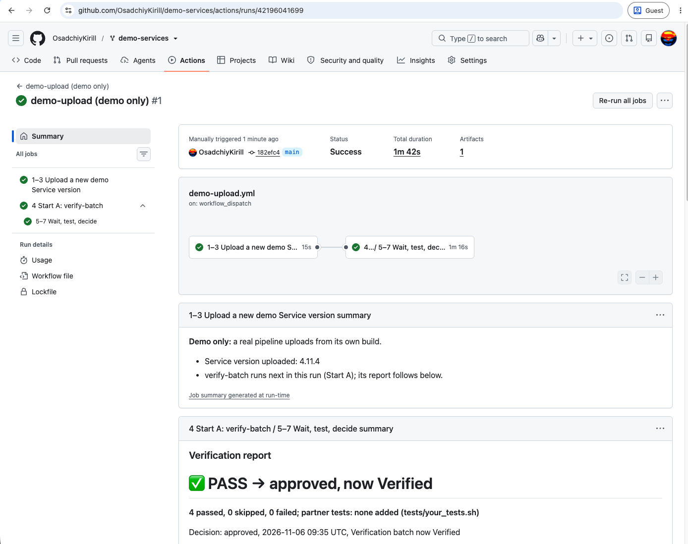
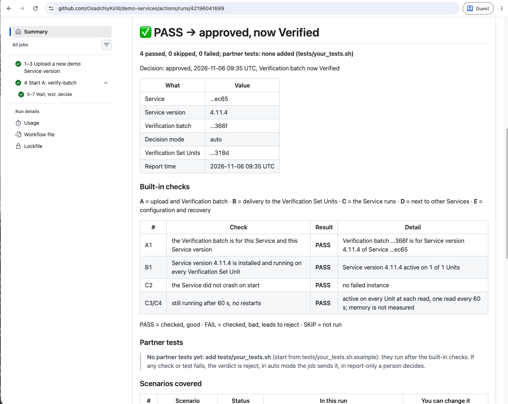

# Run it yourself in 5 steps

You run the whole flow in your own GitHub, with only a browser: upload, wait, checks, decision. It takes about 2 minutes
once the secrets are in. It uses a demo Service and a demo Unit, not yours.

**This is a demo.** `demo-upload` picks the next version and uploads it for you, so that there is something to verify. A
real pipeline uploads from its own build. The job you are trying is `verify-batch`.

## 1. Fork the repository

Open [aosedge/demo-services](https://github.com/aosedge/demo-services), press **Fork**, then **Create fork**.

Your fork is public, like the original: anyone can read its run logs and download its report. The logs hide the ids.

## Before step 2: open the certificate

We sent you a folder with one file per secret: `AOS_API_URL.txt`, `AOS_SERVICE_ID.txt`, `AOS_ROOT_CA_PEM.txt`, the
encrypted `AOS_USER_PEM.7z`, `password.txt` and `README.txt`. Only the `.7z` needs a tool:

| Computer | Tool | How |
|---|---|---|
| macOS | Keka: `brew install --cask keka`, or from keka.io | Open the `.7z` with Keka. Archive Utility, the built-in one, cannot open an encrypted 7z. |
| Windows | 7-Zip, from 7-zip.org | Right-click the `.7z` → 7-Zip → Extract Here. |
| Ubuntu, Debian | `sudo apt install p7zip-full` | `7z x AOS_USER_PEM.7z`. On newer releases the package is `7zip` and the command `7zz x AOS_USER_PEM.7z`. |

When it asks for the password: open `password.txt`, copy the password and paste it. Do not type it. Paste only the
password, with no new line after it. You get `AOS_USER_PEM.pem`.

After the secret is added in step 2, delete the extracted `AOS_USER_PEM.pem`.

## 2. Add the 4 secrets

In your fork: **Settings → Secrets and variables → Actions**. Stay on the tab **Secrets** (not Variables). In the block
**Repository secrets** (not Environment secrets), press **New repository secret**.

The **Name** field is empty, with the grey hint `YOUR_SECRET_NAME`: type the name. In **Secret**, paste the **whole**
content of the file. Press **Add secret**. Do it 4 times:

| Name | Paste the whole content of | What it is |
|---|---|---|
| `AOS_USER_PEM` | `AOS_USER_PEM.pem` | the certificate and key of the demo user. Lines `Bag Attributes …` before the first `-----BEGIN` are fine |
| `AOS_ROOT_CA_PEM` | `AOS_ROOT_CA_PEM.txt` | the root CA of AosCloud |
| `AOS_SERVICE_ID` | `AOS_SERVICE_ID.txt` | the id of the demo Service |
| `AOS_API_URL` | `AOS_API_URL.txt` | the address of AosCloud |

After **Add secret** GitHub shows only the name, never the value: nobody can read a secret back, and pull requests from
other forks do not get it.

Using your own AosCloud account instead? Put your own values in the same 4 secrets. Then skip demo-upload (it builds our
demo Service) and upload your own Service version as you do today; verify-batch and the watch work with your Service
unchanged. See [Setup](docs/setup.md).

## 3. Turn on Actions

Open the **Actions** tab of your fork and press **I understand my workflows, go ahead and enable them**.

You see three workflows: **demo-upload (demo only)**, **verify-batch**, **watch-batches**. watch-batches shows
**Disabled**: GitHub turns schedules off in forks; that is expected.

If the list of workflows stays empty: in your fork open `.github/workflows/demo-upload.yml` (the folder at the top of the repository, not the one under
`verification-example/`), press the pencil (Edit this
file), add a space at the end of the first comment line, press **Commit changes** twice (commit directly to `main`), and
reload the Actions tab after a minute.

If you turn watch-batches on, its scheduled runs still stop at once in a fork ("scheduled watch is off in forks"); a run you
start by hand works.

## 4. Press the button

**Actions → demo-upload (demo only)**. The green **Run workflow** button is at the top right of the workflow page. A small
panel opens with **Branch: main** and **behaviour: good**; leave both, and press the green **Run workflow** in that panel.

The run has two jobs, one after the other, named with the numbers of the diagram: **1–3 Upload a new demo Service
version**, then **4 Start A: verify-batch / 5–7 Wait, test, decide**, which is `verify-batch` started exactly as
[README step 3](README.md#add-it-to-your-repository) shows it (Start A). The whole run takes about 2 minutes
(measured: 1 min 53 s). The upload job is green in about 20 seconds; its summary shows:

- the Service version it uploaded: the highest in AosCloud, plus 1 in the last number;
- "verify-batch runs next in this run (Start A); its report follows below."

## 5. Follow the verify-batch job

Stay on the same run page. Click **4 Start A: verify-batch / 5–7 Wait, test, decide** to see its steps. It takes about
1.5 minutes (measured: 1 min 25 s):

| Step | What you see |
|---|---|
| 5. Wait | The Verification batch appears, the Unit installs the new Service version, and the instance is active |
| 6a, 6b. Test | The built-in checks pass; the partner tests are skipped, as the demo has none. A 60-second observation is part of it |
| 7a. Decide | `7a. Approve` runs: `approved, now Verified (Valid)` |

The whole report is on the run page, below the jobs: there is nothing to download. You need to be signed in to GitHub to see it.

- the verdict, in big: **PASS → approved, now Verified** (or FAIL → rejected; report-only: not sent; no decision);
- Service, Service version, Verification batch, test Units, decision mode and time;
- every built-in check with PASS, FAIL or SKIP, the partner tests, and the scenarios covered;
- the last line: `Full report.html and junit.xml: Artifacts at the bottom of this page`.

If you also have a login: **SP UI → Verification batches** shows the new Service version as **Verified**.

## 6. See a reject (optional)

Press **Run workflow** again and pick **behaviour: crash-on-start**. demo-upload builds the next Service version so that
it fails a start test and exits at once, and uploads it. The upload summary says a reject is expected.

- `5. Wait` sees the instance fail on the Unit and stops waiting.
- `6a` records the failure: **C2** (no crash on start) is **FAIL**, and **B1** too; the 60-second observation and the
  partner tests are skipped, as there is nothing left to observe.
- `7b. Reject` runs, and the run ends red on purpose.

The report on the run page starts with **FAIL → rejected, now Invalid**, and the checks table shows which check failed
and why. **SP UI → Verification batches** shows the Service version as **Invalid**: it never goes to the fleet. The
next good Service version (press again with **good**) is Verified as before.

## If something goes wrong

| What you see | What to do |
|---|---|
| No workflows in the Actions tab, or no **Run workflow** button | Actions are not enabled yet: step 3. |
| Actions enabled, no banner, but "No workflows found" | GitHub has not registered the files yet. Make the one-space edit of step 3 and wait a minute. |
| `Missing secrets: ...` | Add the secrets it names: step 2. Check the spelling, and add them as secrets, not variables. |
| `sed: unterminated` or another odd error right after you added the secrets | A value has an extra line or space. Open the secret (pencil), paste the value again, **Update secret**. The jobs trim the ends now, so this is rare. |
| `The user of AOS_USER_PEM needs the permission deployment_bundles_create` | This certificate may not upload: tell the person who sent you the secrets. |
| The upload job is green, but the verify-batch job is red with `no longer Waiting_validation` | Someone pressed the button in another fork at the same moment and got the same Service version; AosCloud keeps the first upload. Run demo-upload again. |
| `TLS error` or `HTTP 401` or `HTTP 403` | A secret has a wrong value, or the demo user was removed. Paste it again, or tell the person who sent you the secrets. |
| `Unit ... is offline`: the run keeps waiting, up to 30 minutes, then ends red with no decision | The demo Unit is off, so the job rightly decides nothing. Tell the person who sent you the secrets. |
| `no longer Waiting_validation`, red | Another pipeline decided first, or someone decided in the UI. No harm is done. |

## When you are done

Delete the 4 secrets, or the whole fork: **Settings → Danger Zone → Delete this repository**.
