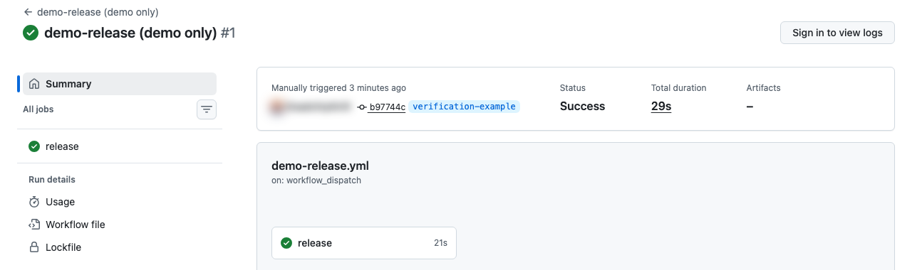
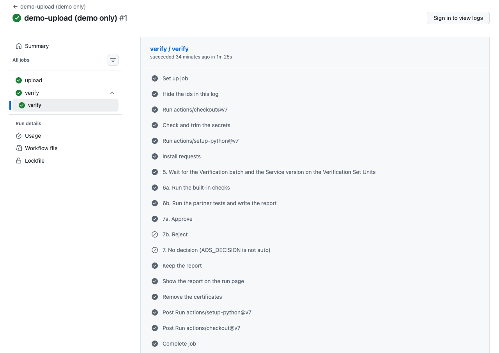

# Run it yourself in 5 steps

You run the whole flow in your own GitHub, with only a browser: upload, wait, checks, decision. It takes about 2 minutes
once the secrets are in. It uses a demo Service and a demo Unit, not yours.

**This is a demo.** `demo-release` picks the next version and uploads it for you, so that there is something to verify. A
real pipeline uploads from its own build. The job you are trying is `verify-batch`.

## 1. Fork the repository

Open [aosedge/demo-services](https://github.com/aosedge/demo-services), press **Fork**, then **Create fork**.

Your fork is public, like the original: anyone can read its run logs and download its report. The logs hide the ids.

## 2. Add the 4 secrets

In your fork: **Settings → Secrets and variables → Actions → New repository secret**. Add each one, with the value we
sent you separately:

| Name | What it is |
|---|---|
| `AOS_USER_PEM` | the certificate and key of the demo user |
| `AOS_ROOT_CA_PEM` | the root CA of AosCloud |
| `AOS_SERVICE_ID` | the id of the demo Service |
| `AOS_API_URL` | the address of AosCloud |

The certificate comes as an encrypted `.7z`: open it with 7-Zip (Windows) or Keka (macOS) and the password we sent, then
paste the whole text of the file, from the first `-----BEGIN` line to the last `-----END` line.

Nobody can read a secret back, and pull requests from other forks do not get it.

## 3. Turn on Actions

Open the **Actions** tab of your fork and press **I understand my workflows, go ahead and enable them**.

If the list of workflows stays empty: in your fork open `.github/workflows/demo-release.yml`, press the pencil (Edit this
file), add a space at the end of the first comment line, press **Commit changes** twice (commit directly to `main`), and
reload the Actions tab after a minute.

The scheduled `watch-batches` stays off in a fork: GitHub keeps schedules off there. You do not need it here.

## 4. Press the button

**Actions → demo-release (demo only) → Run workflow → Run workflow**. Leave the branch as `main`.

In about 30 seconds the run is green (rehearsal: 29 s). Its summary shows:

- the Service version it uploaded: the highest in AosCloud, plus 1 in the last number;
- the link to the `verify-batch` run;
- "The decision is in that run."

## 5. Open the verify-batch run

Follow the link, or open **Actions → verify-batch**. The title is `verify-batch manual <version>`. About 1.5 minutes (rehearsal: 1 min 22 s):

| Step | What you see |
|---|---|
| ⑤ Wait | The Verification batch appears, the Unit installs the new Service version, and the instance is active |
| ⑥ Test | The built-in checks pass; the partner tests are skipped, as the demo has none. A 60-second observation is part of it |
| ⑦ Decide | `7a. Approve` runs: `approved, now Valid` |

The report is under **Artifacts** at the bottom of the run page: `verification-report`, with `report.html` inside.

If you also have a login: **SP UI → Verification batches** shows the new Service version as **Verified**.

## If something goes wrong

| What you see | What to do |
|---|---|
| No workflows in the Actions tab, or no **Run workflow** button | Actions are not enabled yet: step 3. |
| Actions enabled, no banner, but "No workflows found" | GitHub has not registered the files yet. Make the one-space edit of step 3 and wait a minute. |
| `Missing secrets: ...` | Add the secrets it names: step 2. Check the spelling, and add them as secrets, not variables. |
| `The user of AOS_USER_PEM needs the permission deployment_bundles_create` | This certificate may not upload. Tell us. |
| demo-release is green, but verify-batch is red with `no longer Waiting_validation` | Someone pressed the button in another fork at the same moment and got the same Service version; AosCloud keeps the first upload. Run demo-release again. |
| `TLS error` or `HTTP 401` or `HTTP 403` | A secret has a wrong value, or the demo user was removed. Paste it again, or tell us. |
| `Unit ... is offline` and a timeout, red, no decision | The demo Unit is off, so the job rightly decides nothing. Tell us. |
| `no longer Waiting_validation`, red | Another pipeline decided first, or someone decided in the UI. No harm is done. |

## When you are done

Delete the 4 secrets, or the whole fork: **Settings → Danger Zone → Delete this repository**.
