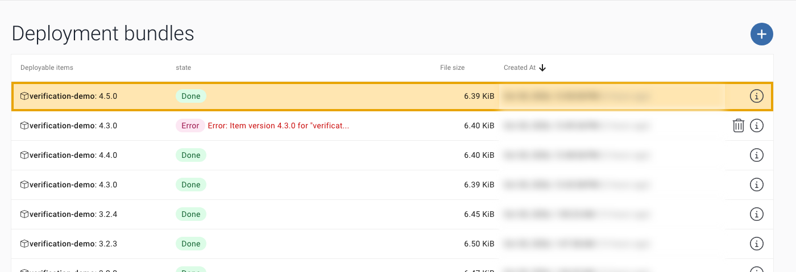

# FAQ and tips

Short answers for running the verification job day to day. For the setup, see the [README](../README.md); for the
calls, see the [API reference](api.md).

## Before you start

GitHub Actions must be enabled for the repository. Organisation owners can switch Actions off for a repository or allow only selected actions; a maintainer cannot see this setting. Workflows used: actions/checkout, actions/setup-python, actions/upload-artifact.

**No run ever appears, no Actions tab.**
Ask an organisation owner to enable Actions for the repository. After enabling, a push to `main` makes GitHub pick up
the schedule.

## Decisions

**Who may approve or reject?**
The Service Provider, with the SP certificate.

**What if a test Unit never gets the version?**
`wait` times out with exit 2, or exit 3 if the Unit is offline, and the job decides nothing. An offline Unit does not
count, even if AosCloud still shows the new version active: that state is old. The batch keeps waiting, with no time
limit. Check that the
Unit is online, in the Verification Set, and linked to the Service through the Subject
([README, prerequisite 2](../README.md#2-verification-configured-oem)). Then run the job again with
`workflow_dispatch`, with the same version. The watch does not start a batch a second time.

**Valid or Verified?**
They are the same. The API says `Valid`, and the UI shows **Verified**. Verified means the version passed the gate;
it then goes on to the fleet through your normal rollout. A batch that waits is `Waiting_validation` in the API and
**Waiting verification** in the UI.

**What does the job never do?**
- It never decides a batch twice.
- It never changes a batch that is already decided: `verify_batch.py` reads the state first, and decides only a
  batch that is `Waiting_validation`.
- It never decides after a timed-out wait.
- It never retries the decision call. If the answer is lost, or AosCloud answers HTTP 5xx, it exits 3: look at the
  batch in the UI before you do anything else.
- It never ends green without a decision, unless you asked for that with `report-only`: any error in `wait` stops the job.

**Can a person decide, and not the pipeline?**
Yes: set `AOS_DECISION` to `report-only`. The job writes the report and sends nothing. See
[Automatic decision](../README.md#automatic-decision).

## The watch: timing and old batches

**Why every 5 minutes?**
AosCloud does not notify a pipeline when a new version waits (no webhook), so the watch asks every 5 minutes. 5 minutes is the shortest interval GitHub allows. GitHub may start runs late or skip them; for a guaranteed start use Start A. Each run takes about 20 s and only reads. To change it, edit one line in `watch-batches.yml`: `cron: "*/5 * * * *"` → `"*/10 * * * *"` (every 10 min), `"*/30 * * * *"`, `"0 * * * *"` (hourly). GitHub cannot read this from a variable. Faster than 5 min, or exact timing: start `verify-batch` right after your upload job (Start A, the chain), or use an external scheduler. A webhook from AosCloud would make it instant (feature request).

The chain is in [`examples/release-caller.yml`](../examples/release-caller.yml).

What it costs: in a public repository, standard GitHub-hosted runners are free, but GitHub turns a schedule off after 60
days without activity. In a private repository every run uses runner minutes: at 5 minutes, about 8,600 minutes a month if
each run counts as one minute, so check your plan or use a longer interval.

**Why not instant?**
AosCloud sends no notification to a pipeline, so the job has to ask. A webhook would make it instant: that
is a feature request for AosCloud. If the upload runs in the same workflow, the chained start begins right after it
([`examples/release-caller.yml`](../examples/release-caller.yml)).

**What about old batches that keep waiting?**
They are ignored. AosCloud moves the Units on to the newest version, and never closes the older batch, so it waits for
ever. The watch takes only the highest version of your Service, even if that one is already decided, and lists the
others as `stale, left alone`. Decide them in the UI if you want the list clean.

**A run timed out. Does the watch try again?**
No: when `verify-batch` already has a run for the batch, in any state, the watch starts no other, so a broken Unit
does not start a job every 5 minutes. That also holds for a run that was cancelled or died on the runner. Fix the
cause, then start `verify-batch` by hand with the version.

**A new version arrives during the tests.**
The Units move on to it, so the older version stops running: its checks fail and its batch is rejected, even if it was
good. The new version gets its own run. Nothing wrong gets approved.

**Two runs for one version?**
It can happen: the watch does not see a chained run, because GitHub lists it under the calling workflow. If the watch
asks during a chained run, the two queue, one after the other. The second finds the batch decided, stops with
`no longer Waiting_validation`, sends nothing, and shows red. No harm is done.

**Can a decision be overwritten?**
AosCloud accepts a decision on a batch that is already decided, and the last one wins. The job reads the state right
before its one call, but the server has no lock: a person who decides in the UI in that same moment can be overwritten.

**I want a person to confirm.**
Required reviewers on the environment `aos-verification` would stop the watch at every run, too. Keep the watch in an
environment of its own, with the same secrets and no reviewers: change the `environment:` line of
`watch-batches.yml`.

**`no test Unit for arm64`.**
The batch needs a decision for an architecture that has no test Unit. The job will not approve what it did not test,
so the watch run stays red and nothing starts until you add a Unit of that architecture to the Verification Set, or
decide in the UI.

## Running it

**Where do I see the batch?**
SP UI → Verification batches. The job prints the batch id in its log.

**I uploaded the same version again, and no batch appeared.**
A version can be uploaded only once. The bundle ends in **Error** ("Item version … already exists"), and no batch is
created, so `wait` times out. Raise `items[].version` in `config.yaml` and upload again.

**A broken version.**
A version that cannot start may restart a few times on the Unit before its instance is marked failed. `wait` then
stops with exit 1 and prints the batch id, and the job rejects it without running your tests.

**`aos-signer` prints my user name and e-mail.**
On `sign` and `upload`, `aos-signer` prints the user of the certificate (its common name, which holds your user name
and e-mail). In CI, mask this line, or keep the job logs private.

## Connection

**The calls hang or fail with a TLS error.**
The runner needs outgoing TCP **10000** to the API host, **without TLS inspection**: a proxy or security product
that decrypts TLS breaks mutual TLS. Ask your network team for a pass-through rule for `<api host>:10000`.

**My certificate expires.**
A user certificate has an end date. Renew it before that date, run `./aos-verify setup` again (it makes the PEM from the
new `.p12`), and replace the `AOS_USER_PEM` secret with the line `./aos-verify secrets` prints. Check the date with
`openssl x509 -in .aos-verify/user.pem -noout -enddate`.

**`unknown ca` when connecting.**
The error reads `tlsv1 alert unknown ca`: the certificate is from another AosCloud, or the PEM file has no intermediate
certificates. `./aos-verify setup` makes it right; by hand, without `-clcerts`:
`openssl pkcs12 -in "$AOS_P12" -nodes -out user.pem`. The file then holds the certificate, the
intermediate certificates and the key. Replace the `AOS_USER_PEM` secret.

**`Can't open aos-user-sp.p12`.**
You are not in the folder of the file. Put the full path into `AOS_P12` and use it:
`openssl pkcs12 -in "$AOS_P12" -nodes -out user.pem`. `find ~/.aos/security -name "*.p12"` lists your files.

**`Mac verify error: invalid password?`**
A wrong password of the `.p12` file. It is the file's password, not the one of your computer, and it is often empty:
press Enter. MAC is the integrity check of the file.

**`ls` prints an error such as `--icons`.**
Your shell has an alias for `ls` (eza, lsd). The steps use `find`, which no alias changes.

**I have several certificates.**
`aos-keys` saves one `.p12` per AosCloud and role, for example `~/.aos/security/aos-user-sp.p12` and
`~/.aos/security/prod/aos-user-sp-prod.p12`. Use the SP certificate of the AosCloud in `AOS_API_URL`. A wrong one
ends in `HTTP 401`, `HTTP 403` or a TLS error in `verify_batch.py check`.

**We use a proxy.**
`verify_batch.py` (through `requests`) and `curl` honour `HTTPS_PROXY` and `NO_PROXY`. If the runner can reach the
API host directly, add it to `NO_PROXY`; if the proxy is the only way out, it must pass port 10000 through without
TLS inspection.

## Security

**What does a public run show?**
The job masks the batch, Unit and Service ids in its log. Two things stay visible: the run title carries the batch id,
because the watch finds its runs by it; and the variable `AOS_API_URL` shows your API host. Keep the repository private
if that matters.

**The PEM secret holds the private key.**
Anyone who can run a workflow with this secret can act as your SP user. The job reads the secrets from the GitHub
environment `aos-verification`: add required reviewers and protected branches there (GitHub offers required reviewers in a private repository only on
its Enterprise plan; the call ends in HTTP 422 otherwise). The job writes the PEM to a
folder of the runner that only it can read, only in the steps that call AosCloud (the discover step of the watch, wait,
the built-in checks, the decision), and deletes it at the end of each. Your tests run in a step of their own, with no
secret and no key file. Delete local copies of the PEM (`.aos-verify/user.pem`) after you store the secret.

**The certificate leaked.**
Delete the CI user, not only the certificate. Six permissions cannot be removed from an SP user, among them
`user_certificates_download` and `users_new_token`, so whoever holds the certificate may already hold another way in.
Then create a new user with the permissions the job needs, and store its PEM as the secret. Look at the batches decided
since the leak in SP UI → Verification batches.

**What to hide in screenshots and videos?**
`aos-signer` prints your e-mail on upload (`Upload info: user=…`). That line is not from this example: mask it.

**Next →** back to the start: [How to use this repository](../README.md#how-to-use-this-repository)
