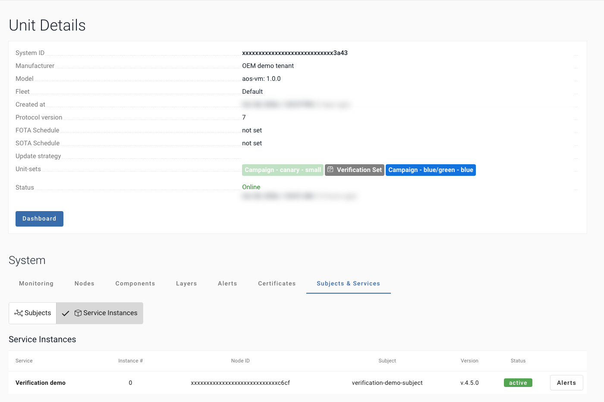
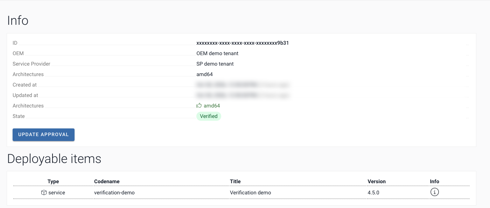
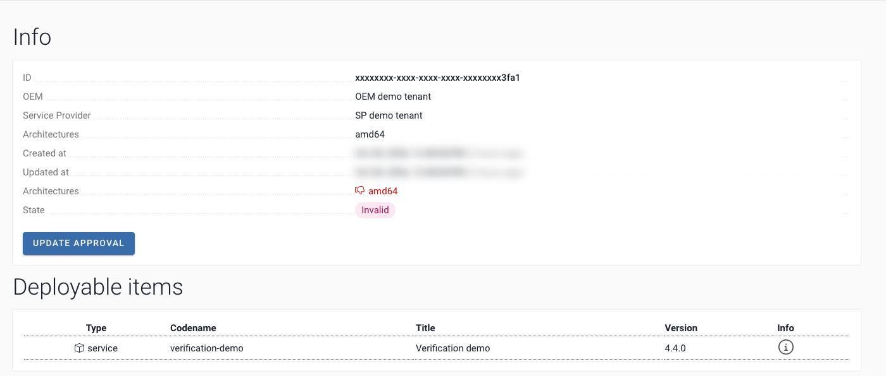

# How it works

What happens between the upload and the decision, step by step. The numbers 1 to 7 are those of the diagrams and of
the step names in the workflows.

## Step by step

| # | Step | Runs where | What is checked / decided | Where you see it |
|---|---|---|---|---|
| 1 | Upload (existing step) | CI pipeline | New Service version sent | SP UI: Deployment bundles |
| 2 | Verification batch created | AosCloud | State: Waiting verification | SP UI: Verification batches |
| 3 | Installed on the test Units, which report installed, active or failed | Verification Set Units | Installed, active or failed | SP UI: Unit → Subjects & Services |
| 4 | Start: A, your upload job (main), or B, the watch, every 5 min (fallback) | upload job, or `watch-batches.yml` | New Service version waiting? | Job log |
| 5 | Wait | `verify-batch.yml` | test Units active | Job log |
| 6 | Test | `verify-batch.yml` | Built-in checks + partner tests | The run page: the whole report |
| 7 | Decide | `verify-batch.yml` | `auto`: the job. `report-only`: a person | The run page; job log |
| – | Result | AosCloud | Verified / Invalid | SP UI: Verification batches |

## The verification job: 5 Wait, 6 Test, 7 Decide

All calls use mutual TLS with the SP certificate on `https://<api host>:10000/api/v11/`. Each call links to its
description, with a `curl` example and a sample response, in the [API reference](api.md).

### 5. Wait: `verify_batch.py wait`

It finds the Verification batch of this Service and Service version, takes the Verification Set Units from AosCloud (or from the `units` input or
`AOS_TEST_UNITS`, if you set them), then waits until the Service version runs on every test Unit.

- `GET verification-batch/?ordering=-created_at&limit=50&offset=<n>`, page by page: [find the batch](api.md#find-the-verification-batch)
- `GET verification-batch/{batch_id}/`: [check that it still waits](api.md#read-the-verification-batch)
- `GET verification-batch/{batch_id}/statistics/` and `GET services/{service_id}/units/`: [the test Units](api.md#the-units-of-the-verification-set).
  Units you give must be in the Set, and every architecture of the batch needs one, because the decision covers them all
- `GET units/{unit_id}/`: [is the test Unit online](api.md#is-the-unit-online)
- `GET units/{unit_id}/subjects-services/{service_id}/`: [the Service version on each test Unit](api.md#read-the-service-version-on-a-unit)

Exit 0: ready, and the batch id is printed. Exit 1: the Service version failed to start on a Unit, the batch id is printed,
and the job rejects. Exit 2: timed out, no batch, the batch is already decided, or an error that waiting cannot fix
(a setting, a TLS error, an HTTP 4xx answer); the job decides nothing. Exit 3: timed out while AosCloud could not be
reached or a test Unit was offline; the job decides nothing. Only a lost connection, a timeout and HTTP 5xx are retried.



### 6. Test: `tests/run_tests.sh`

The built-in checks run first: they read the Verification batch and the Units again (exactly this Service version, on every Unit, no crash) and
observe the Service version for 60 s (late failure, restarts). Then partner tests, from `tests/your_tests.sh` when you add it
([Checks and the report](tests.md)), in a step of their own, with no secret. Exit 0 when every check passed, 1 when a check
failed, 3 when AosCloud could not be read or a test Unit is offline: neither decides anything. It writes `report/report.html`,
`report/report.md` and `report/junit.xml`, from the same results.

The whole report is on the run page, as the job summary, with the decision in it: the verdict, the Service, the Service
version, the Verification batch, the test Units, every check, the partner tests and the scenarios covered. Nothing to
download. `report.html` and `junit.xml` are under **Artifacts** → **verification-report** at the bottom of the run page.
When nothing ran (a timeout, no Verification batch), the summary says "No decision" and why.

### 7. Decide: `verify_batch.py decide --approve` or `--reject`

It reads the Verification batch once more, refuses unless the state is `Waiting_validation` (UI: Waiting verification), prints
the architectures it decides (all of the batch), and sends one call, with no retry:

- `PATCH verification-batch/{batch_id}/` with `[{"architecture": "amd64", "is_approved": true}]`:
  [approve or reject](api.md#approve-or-reject)

If your test Units do not cover every architecture of the batch, pass `--arch` for the ones you tested.

Approved: the batch becomes **Valid** (**Verified** in the UI): the Service version passed the gate, and it goes on to the
fleet through your normal rollout. Rejected: **Invalid**, and it stops here.

| Approved | Rejected |
|---|---|
|  |  |

## Decision modes

**Defaults:** the job decides by itself (`AOS_DECISION=auto`). For a decision by a person, set `AOS_DECISION=report-only`: the job only checks and writes the report, and a person approves or rejects in the SP UI. Or `ask` (laptop only).

Built-in checks run on every Service version ([what they check](tests.md)). Add your own tests in `tests/your_tests.sh` (start from `tests/your_tests.sh.example`): they run after the built-in checks. If any check or test fails, the verdict is reject; in `auto` mode the job sends it, in `report-only` a person decides.

One setting, `AOS_DECISION`, says what happens after the checks:

| Value | What happens | When to use it |
|---|---|---|
| `auto` | all checks pass: approve; a check fails: reject. The default in GitHub | you trust the checks, and nobody has to press anything |
| `ask` | it asks before it sends the decision. The default on a laptop; in GitHub there is no terminal to ask in, so it sends nothing | you run it by hand, and want to read the report first |
| `report-only` | the report and `junit.xml` only, no decision sent; a person decides in SP UI → Verification batches → the batch → **Update approval** | you do not want the pipeline to release by itself. GitHub required reviewers are not on every plan; this works on all of them |

Reject is automatic too: with `auto`, a Service version that fails is rejected with no person involved.

In GitHub, set the variable `AOS_DECISION` in the environment `aos-verification`:

```bash
gh variable set AOS_DECISION --repo your-org/your-repo --env aos-verification --body report-only
```

On a laptop, `./aos-verify setup` asks once and keeps your answer in `.aos-verify.env`. `AOS_DECISION` in your environment
wins over that for one run, and `./aos-verify run --yes` is the short form of `auto`.

With `report-only` the job is still green or red: green when all checks pass, red when one fails.

The mode in use is on the first line of `./aos-verify run` and in the header of the report, which is also the GitHub job summary.

## The watch (Start B)

The fallback start. [`watch-batches.yml`](../.github/workflows/watch-batches.yml) asks AosCloud on a schedule whether a
new Service version of your Service waits, and starts `verify-batch` for it: step 4, B. It only reads. It has to be on
the default branch: GitHub runs a schedule only from there. Its settings: [Setup, Start B](setup.md#start-b-the-watch).

**Why every 5 minutes?**
AosCloud does not notify a pipeline when a new Service version waits (no webhook), so the watch asks every 5 minutes. 5 minutes is the shortest interval GitHub allows. GitHub may start runs late or skip them; for a guaranteed start use Start A. Each run takes about 20 s and only reads. To change it, edit one line in `watch-batches.yml`: `cron: "*/5 * * * *"` → `"*/10 * * * *"` (every 10 min), `"*/30 * * * *"`, `"0 * * * *"` (hourly). GitHub cannot read this from a variable. Faster than 5 min, or exact timing: start `verify-batch` right after your upload job (Start A), or use an external scheduler. A webhook from AosCloud would make it instant (feature request).

Old batches, timed-out runs, two pipelines on one Service: [FAQ, the watch](faq.md#the-watch-timing-and-old-verification-batches).

## Who tells whom

AosCloud sends no notification to a pipeline; a webhook would replace the watch. So the upload job starts the
verification itself (Start A), or the watch asks on a schedule (Start B), with the SP certificate alone.

![Who tells whom, in 7 steps. 1, upload with aos-signer upload, an existing step. 2, AosCloud creates a Verification batch, Waiting verification; the Service version goes only to the Set. 3, the Service version is installed on the test Units, and they report installed, active or failed. 4, Start: A, the main start, the upload job starts verify-batch.yml right after the upload; or B, the fallback, the watch: watch-batches.yml repeats every 5 minutes: is a new Service version waiting for verification? GET Verification batches, statistics and Units returns the batch id, the Service version and the Unit ids of the Set. AosCloud sends no notification, so the watch asks; 5 minutes is GitHub's minimum, best effort. One run of verify-batch.yml per batch. 5, wait: each Unit until active or failed. 6, built-in checks and partner tests, then the report; the built-in checks read the Units in AosCloud for 60 s. 7, decision: auto, one PATCH, approve or reject, only while still in Waiting verification; report-only, no PATCH, a person decides in the SP UI. Verified goes to the normal rollout; Invalid: the rollout stops.](img/sequence.svg)

[Open the diagram at full size](https://raw.githubusercontent.com/aosedge/demo-services/main/verification-example/docs/img/sequence.svg)

| Who | Tells whom | What | Where you see it |
|---|---|---|---|
| Your upload job | AosCloud | a new Service version | the job log; SP UI → Deployment bundles |
| AosCloud | the Verification Set Units | install this Service version | SP UI → Verification batches: Waiting verification |
| A test Unit | AosCloud | installed, and active or failed | SP UI → Unit → Subjects & Services → Service Instances |
| AosCloud, when the watch asks | the watch | the batch id, the Service version, the Unit ids of the Set | the log of `watch-batches`; the title of the `verify-batch` run |
| The verification job | AosCloud | one decision: approve or reject | the report; SP UI: Verified or Invalid |

Two starts, no buttons:

- **Start A (main):** your upload job calls the verification right after the upload, in the same workflow.
- **Start B (fallback), the watch:** it asks AosCloud itself and finds any upload, wherever it came from. GitHub runs a
  schedule on a best-effort basis, so the watch can be late.

Both end in the same `verify-batch`, in one queue per Service version in one repository: a second run waits for the
first, finds the batch decided, and sends nothing. Two repositories on one Service are not queued:
[FAQ, the watch](faq.md#the-watch-timing-and-old-verification-batches), Two pipelines on one Service.

## Tested on AosCloud

| Date | Where | What ran | Result |
|---|---|---|---|
| 06.11.2026 | GitHub | A reject: `demo-upload` with behaviour crash-on-start uploaded 4.11.5; its job `verify` saw the instance fail (B1, C2 FAIL) and rejected it | Invalid, the whole run took 45 s |
| 06.11.2026 | GitHub | The TRY_IT walkthrough, a fresh fork in a guest window: `demo-upload`, pressed once, uploaded 4.11.4, and its job `verify` ran `verify-batch` (Start A) | Verified, the whole run took 1 min 42 s |
| 06.11.2026 | GitHub | Start A through `workflow_call`, in a fork: `demo-upload`, pressed once, uploaded 4.11.3, and its job `verify` ran `verify-batch` | Verified, the whole run took 1 min 53 s |
| 06.11.2026 | GitHub | A fresh fork, only a browser: `demo-upload`, pressed once, uploaded 4.11.2 and started `verify-batch` with a dispatch | Verified, the `verify-batch` run took 1 min 22 s |
| 05.11.2026 | GitHub | `demo-upload`, pressed once: it uploaded 4.11.1 and started `verify-batch` with a dispatch | Verified about 1.5 min after the upload, with no further step |
| 05.11.2026 | GitHub | Start B: the watch, started by hand, found 4.11.0 | Verified in 1 min 23 s |
| 30.10.2026 | Terminal | The same three steps | Active on the test Unit in about 15 s, Verified |

Production AosCloud 6.1.97. What has not run yet: [FAQ, Limits](faq.md#limits).

**Next →** [Checks and the report](tests.md)
