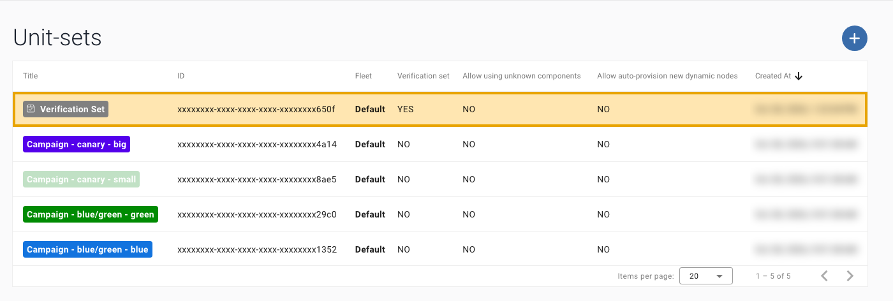
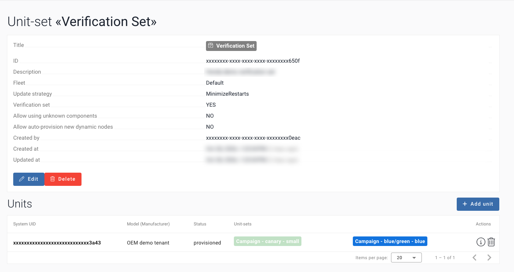
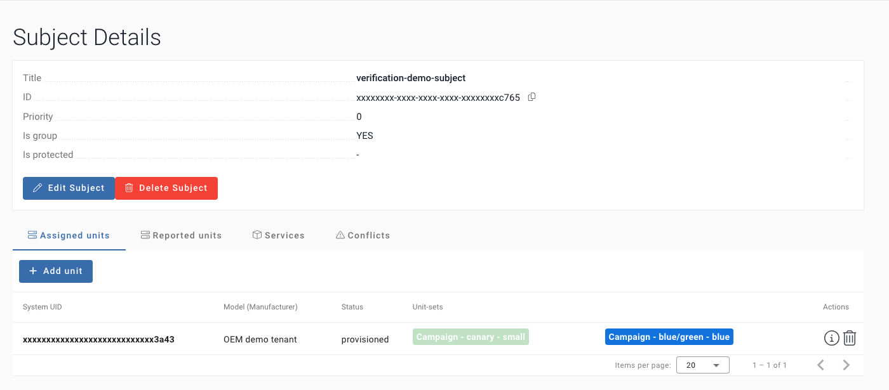
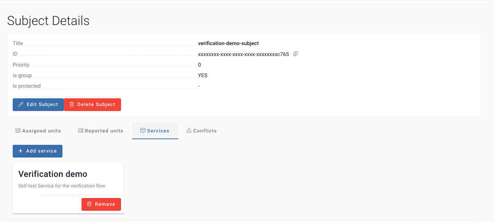
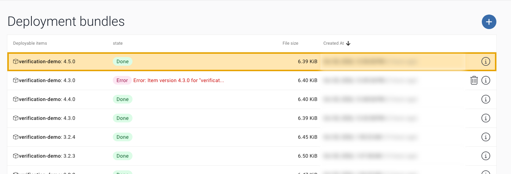
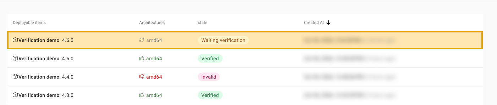
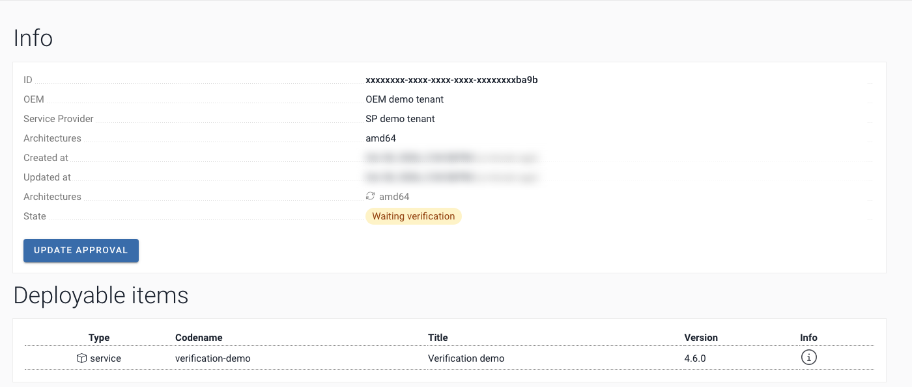

# Setup

Everything that has to be in place before the first run, and the settings of the job. The short version is in the
[README](../README.md#add-it-to-your-pipeline).

## Before you start

GitHub Actions must be enabled for the repository. Organisation owners can switch Actions off for a repository or allow only selected actions; a maintainer cannot see this setting. Workflows used: actions/checkout, actions/setup-python, actions/upload-artifact.

## Who has to act

Who has to act before the first run:

| What | Who |
|---|---|
| Verification Set, test Units, Subject with your Service | OEM, once ([B](#b-verification-configured-oem)) |
| A CI user with 9 permissions and its certificate | SP, once (a user who may create users) ([A](#a-a-service-that-your-pipeline-already-deploys-sp)) |
| Actions enabled; environment `aos-verification` | GitHub organisation owner; repository admin |
| Two workflow files, `verify_batch.py`, `tests/`, four secrets | You |

## Prerequisites

### A. A Service that your pipeline already deploys (SP)

1. The Service exists in AosCloud for your Service Provider (SP) account: SP UI → Services, or
   `POST services/ {title, codename, default_quotas}`
   ([services_create](https://api.aoscloud.io/api/v11/docs#/services/services_create)).
2. Note its **Service id**. The job finds the Service version by this id. It is the `id` of the item with your `codename` in
   `GET services/?search=<codename>` ([find the Service id](api.md#find-the-service-id)).
3. Your pipeline signs and uploads it with `aos-signer`, using the SP user certificate (`.p12`).
4. **A CI user for the job**: an SP user of its own, so that its certificate can be revoked alone. It needs these
   permissions: `verification_batch_list`, `verification_batch_read`, `verification_batch_statistics`,
   `verification_batch_approval`, `services_units_list`, `units_read`, `units_subjects_services_read`, `users_me`,
   `user_certificates_create`. Add `deployment_bundles_create` only if the same user uploads, as `demo-upload` does.
   `POST users/` also gives it the group `sp_management`; take it away with `PATCH users/{id}/ {"permission_groups": []}`.

### B. Verification configured (OEM)

The OEM account does these steps once. The new Service version then goes to these Units first, and to no other Unit.

1. **Create the Verification Set**: a Unit Set with **Verification set = YES**, in the fleet of its Units.
   OEM UI → Unit-sets → +, or `POST unit-sets/ {title, is_validation_set: true, fleet, description}`
   ([unit_sets_create](https://api.aoscloud.io/api/v11/docs#/unit-sets/unit_sets_create)).

   

2. **Add the Verification Set Units** to it: Add unit, or `POST unit-sets/{id}/units/ {system_uids}`
   ([unit_sets_units_create](https://api.aoscloud.io/api/v11/docs#/unit-sets/unit_sets_units_create)).
   The Units must be provisioned and online.

   

3. **Create a Subject for the test Units**: a group Subject, priority 0, with the test Units assigned.
   `POST subjects/ {label, is_group: true, priority: 0}`
   ([subjects_create](https://api.aoscloud.io/api/v11/docs#/subjects/subjects_create)), then
   `POST subjects/{id}/units/ {system_uids}`
   ([subjects_units_create](https://api.aoscloud.io/api/v11/docs#/subjects/subjects_units_create)).

   

4. **Give your Service to the Subject**: Services tab → Add service, or `POST subjects/{id}/services/ {service_ids}`
   ([subjects_services_create](https://api.aoscloud.io/api/v11/docs#/subjects/subjects_services_create)).
   Without this link the Service version is never installed on the test Units.

   

You do not need to give the job the ids of the test Units: with the SP certificate it reads them from each Verification batch
([which Units](api.md#the-units-of-the-verification-set)). The SP cannot read Unit Sets directly.

### C. A Service version uploaded, so that a Verification batch exists (SP)

1. In the `config.yaml` of the Service, these parameters matter:

   | Parameter | Why |
   |---|---|
   | `items[].identity.codename` | the codename of your Service |
   | `items[].identity.id` (optional) | your Service id: the upload adds a Service version to that Service |
   | `items[].version` | the new Service version. It must be higher than the last one and never uploaded before |
   | `items[].images[].archInfo.architecture` | what the image is built for. The batch lists the architectures it needs an approval for: for example, `amd64` for an image built for `any`. `decide` sends one approval for each |
   | `publish.tlsKey` | the path of the SP `.p12`. Keep the file out of the repository |

2. Run `aos-signer sign` and `aos-signer upload` in the folder of the Service.
3. SP UI → Deployment bundles: the Service version is **Done**. An **Error** such as "Item Service version … already exists" means
   that the Service version was reused: raise it.

   

4. SP UI → Verification batches: AosCloud creates one batch per uploaded Service version. It waits for a decision, with no
   time limit: the API state is `Waiting_validation`, and the UI shows **Waiting verification**.

   

   

## Copy the files

From the folder of this example:

```bash
mkdir -p /path/to/your-repo/.github/workflows
cp .github/workflows/verify-batch.yml .github/workflows/watch-batches.yml /path/to/your-repo/.github/workflows/
cp -R verify_batch.py tests /path/to/your-repo/
```

Demo only, not for your repository: `.github/workflows/demo-upload.yml`, `demo-service/`, `TRY_IT.md`.

## Secrets

One helper prints exactly what to paste. It makes the PEM from your `.p12`, finds the root CA and your Service (the
first time it asks, as `setup` does), and never prints the key:

```bash
./aos-verify secrets --repo your-org/your-repo
```

```text
gh api -X PUT repos/your-org/your-repo/environments/aos-verification
gh secret set AOS_USER_PEM --repo your-org/your-repo --env aos-verification < '…/.aos-verify/user.pem'
gh secret set AOS_ROOT_CA_PEM --repo your-org/your-repo --env aos-verification < '…/.aos-verify/aos-root-ca.crt'
gh secret set AOS_SERVICE_ID --repo your-org/your-repo --env aos-verification < '…/.aos-verify/service_id'
gh secret set AOS_API_URL --repo your-org/your-repo --env aos-verification --body 'https://api.aoscloud.io:10000/api/v11'
```

Creating the environment needs admin rights on the repository.

## Start A: after your upload

The main start. Add the `verify` job of [`examples/release-caller.yml`](../examples/release-caller.yml) after your
`aos-signer upload` step; the upload job gives the uploaded version as its output `version`. Then commit to the default
branch. [`verify-batch`](../.github/workflows/verify-batch.yml) checks the Service version and decides, by itself
([Decision modes](how-it-works.md#decision-modes) says how to change that). Add your own tests in
[`tests/your_tests.sh`](tests.md).

## Start B: the watch

The fallback start; it also finds uploads made elsewhere, when GitHub runs its schedule.
[`.github/workflows/watch-batches.yml`](../.github/workflows/watch-batches.yml) has to be on the default branch: GitHub
runs a schedule only from there. It needs `AOS_API_URL`, `AOS_SERVICE_ID`, `AOS_USER_PEM` and `AOS_ROOT_CA_PEM`, from
[Parameters](#parameters). `AOS_TEST_UNITS` is optional: the job takes the Units from AosCloud. Why it asks every 5
minutes, and how to change that: [How it works, the watch](how-it-works.md#the-watch-start-b).

## Parameters

`./aos-verify secrets` prints the commands for the four required values: [Secrets](#secrets). By hand:
create the environment `aos-verification`, put the secrets there, and, if you want a person to confirm, add required
reviewers (repository Settings → Environments) or set `AOS_DECISION` to `report-only`. The variables go in Settings → Secrets and variables → Actions.
How to make the PEM from your `.p12` and where the root CA is:
[Run it from your terminal, appendix, step 3](run-locally.md#3-your-certificate).

| Name | Kind | Value |
|---|---|---|
| `AOS_API_URL` | secret or variable | `https://api.aoscloud.io:10000/api/v11`, or your API host. A secret wins over a variable of the same name |
| `AOS_USER_PEM` | secret | one PEM file with the SP user certificate, the intermediate certificates and the key (see below) |
| `AOS_ROOT_CA_PEM` | secret | the AosEdge root CA file `aos-root-ca.crt` (from `aos-keys`, see below; it is not secret) |
| `AOS_SERVICE_ID` | secret | your Service id; it is not secret, but GitHub masks a secret in the log |
| `AOS_TEST_UNITS` | variable | optional: test only these Units of the Verification Set; ids separated by spaces. A Unit you leave out is not checked. The job stops if one is outside the Set, or if an architecture of the Verification batch has none |
| `AOS_DECISION` | variable | `auto` (default), `ask` or `report-only`: [Decision modes](how-it-works.md#decision-modes) |
| `AOS_WATCH` | repository variable (not in the environment) | `off` pauses the scheduled watch; not set or `on`: it runs. Not related to `AOS_WATCH_SECONDS` |
| `AOS_WATCH_SECONDS` | variable (on a laptop: environment) | how long the built-in checks observe the Service version on the Verification Set Units; default `60`, `0` turns it off. See [Example checks](checks.md#c3-late-failure) |
| `AOS_WAIT_TIMEOUT` | variable (on a laptop: environment) | seconds to wait for the Service version on the Units; default `1800`. The job stops after 60 minutes |
| `version` | workflow input | the Service version to verify; to start the job by hand, this is the only input you need |
| `service_id`, `batch_id`, `units` | workflow inputs | optional: the Service (default `AOS_SERVICE_ID`), the batch (default found by the Service version), the test Units, separated by spaces |

## Security

The certificate secret holds the private key of your SP user. The job reads it from the environment
`aos-verification` and writes it to a folder of the runner that only the job can read, only for the steps that call
AosCloud: the watch's discover step, wait, the built-in checks and the decision. Partner tests (`tests/your_tests.sh`) run
in a step of their own, with no secret and no key file. Each step deletes the file when it ends. The job masks the
Verification batch and Unit ids in its log; [what stays visible](faq.md#security) matters in a public repository. More: [FAQ, Security](faq.md#security).

## Who maintains this

AosEdge team; contact: the person who sent you this link. From the zip: open `START_HERE.html` (offline, all pages and
the video).

**Next →** [How it works](how-it-works.md)
