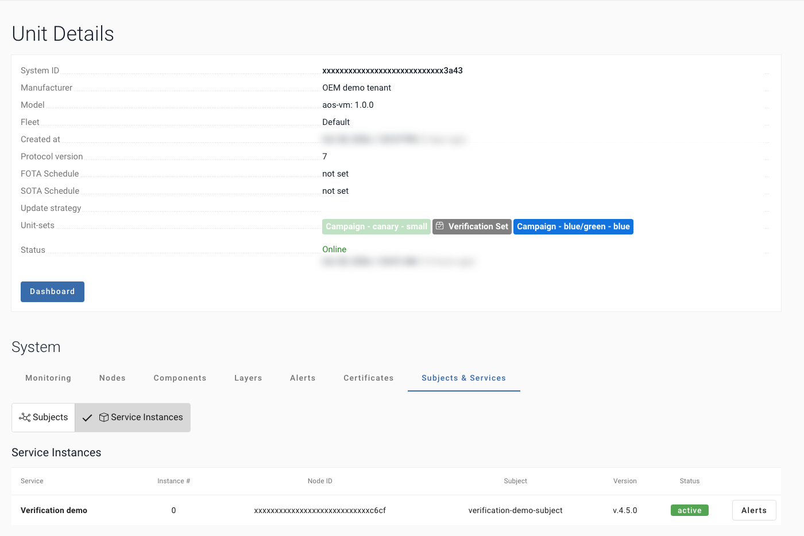

# Your tests

This page says what `tests/run_tests.sh` checks, what its report shows, how to add your own tests, and how to check
the example itself.

## What `tests/run_tests.sh` does

It runs after `wait`, and takes no arguments. `./aos-verify run` and `./aos-verify test` give it its values
(`SERVICE_ID`, `VERSION`, `BATCH`, `UNIT_ID`); in the job they come from the workflow.

1. **The built-in checks**, read-only, against AosCloud:

   | Check | What it checks |
   |---|---|
   | A1 | the batch holds exactly this Service and version, and still waits |
   | B1 | the version is installed and active on every test Unit |
   | C2 | no instance of the version failed |
   | C3/C4 | the observation: every 60 s for `WATCH_SECONDS` (default 60, `0` = off), the version still runs on every Unit. It reads once every 60 s, and it does not measure memory |

2. **Your tests**, from `tests/your_tests.sh`, when the file exists.
3. **The report**: `report/report.html` and `report/junit.xml`. In the job: the run page → **Artifacts** →
   **verification-report**.

**Exit 0 approves the version. Exit 1 (a check failed) rejects it**, unless you changed that with
[`AOS_DECISION`](../README.md#automatic-decision). After the decision the report says what was done. Exit 2 means a value is missing. Exit 3 means
AosCloud could not be read or a test Unit is offline: nothing is decided, because neither says anything about the version.



## Add your own tests

Start from the example. It has three tests that need your values, so they fail until you change them:

```bash
cp tests/your_tests.sh.example tests/your_tests.sh
```

One line per test, with `check <name> <command>`: your test-bench script, a pytest suite, an HTTP check against a
Unit:

```bash
check bench_suite ./bench/run_suite.sh --version "$VERSION"
check acceptance python -m pytest -q acceptance/
check health curl -fsS --max-time 10 "http://$UNIT_HOST:8080/health"
```

The rule: print one line per test, `PASS <name>` or `FAIL <name>: <why>`, and exit 0 only when every test passed.
`tests/run_tests.sh` puts these lines into the report, in their own section; until you add the file, an amber line there says so. Your tests get `SERVICE_ID`, `VERSION`,
`BATCH_ID` and `UNIT_ID` (or `AOS_TEST_UNITS`) in their environment, but not `AOS_CERT`; in the job they run in a step
with no secret. An HTTP check needs a
network path from the runner to the test Unit.

Examples of checks for the 12 scenarios we ran on production: [Example checks](checks.md).

## Check the example itself

`tests/test_verify_batch.py` runs `verify_batch.py` against a small in-memory AosCloud, with no network: `discover`
(the highest version, stale batches, the Units in both lists, `--dry-run`), `check`, `status`, wait, a version that failed or is still starting, a timeout, paging through the batches, errors that stop at
once (HTTP 4xx, TLS, a missing setting, no test Units, any unexpected error) and outages that are retried, approve,
reject, `--arch`, a decided batch, a batch with no architectures, HTTP 5xx after the decision, an empty answer, and a
lost answer. With `bash`, it also runs `tests/run_tests.sh` (the built-in checks, the observation, your tests, the report, the exit
codes) and steps of the workflows: the job never ends green without a decision, stops on an empty secret, and deletes
the key; the watch, with a stand-in for `gh`, starts one run per batch.

```bash
pip install pytest requests
```

```bash
python -m pytest -q
```

You should see `164 passed`. Without `bash` (plain Windows), the 48 tests that use `bash` are skipped.

**Next →** [Example checks](checks.md): 12 scenarios we ran on production, with the code
